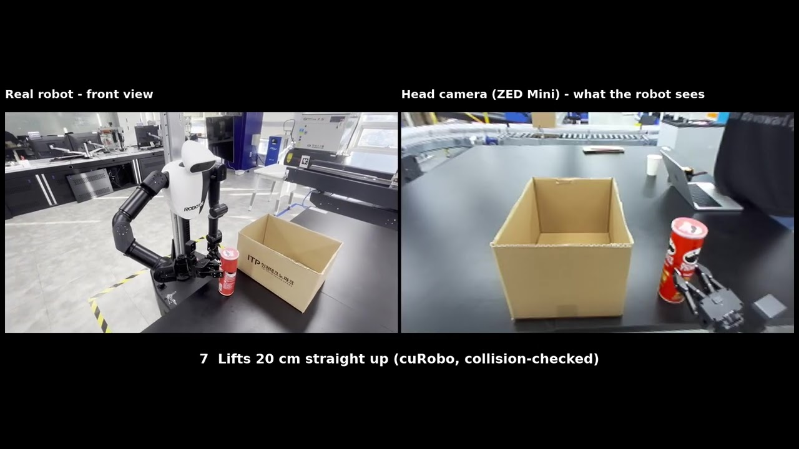

# real-manipulation

ROBOTIS AI Worker(FFW-SG2)를 물류창고 맵의 Isaac Sim 디지털 트윈과 실물 로봇에서
함께 다루는 레포입니다. 머리 카메라 RGB-D 한 장과 문장 하나("빨간 프링글스 통을
집어서 종이 상자에 넣어")만 주면 오른팔로 집어 옮기는 파이프라인(C-RADIO →
GraspGenX → cuRobo)과, 같은 코드를 Isaac Sim과 실물 양쪽에서 돌리기 위한 장면,
ROS 2 연결, 주행(Nav2), 녹화 도구를 담고 있습니다.

### ▶ 실물 시연 영상 (YouTube)

[](https://youtu.be/BpTbZfzxGVI)

위 이미지를 누르면 YouTube에서 재생됩니다 — https://youtu.be/BpTbZfzxGVI

영상은 실물 로봇에서 한 번 실행한 결과입니다. 성공률을 재지 않았고 벤치마크가
아닙니다. 통을 몸체 낮은 곳의 중심에서 벗어난 자리로 잡고, 상자 테두리보다
조금 위(상자 바닥에서 약 26 cm)에서 놓아 떨어뜨립니다. 내려놓으려면 손과 상자
벽 사이에 플래너가 찾은 것보다 더 큰 여유가 필요합니다.

## 환경

아래 조합에서 돌렸습니다. 파이프라인은 conda 환경 두 개를 씁니다. Isaac Sim 쪽은
Isaac Lab과 버전이 어긋나면 API 수준에서 바로 깨지므로 그대로 맞추시기 바랍니다.

| | `env_isaaclab` (Isaac Sim) | `graspgenx` (C-RADIO, GraspGenX, cuRobo) |
|---|---|---|
| Python | 3.11.15 | 3.11.16 |
| PyTorch | 2.7.0+cu128 | 2.8.0+cu128 |
| Isaac Sim / Isaac Lab | 5.1.0 (pip) / 2.3.2 (tag `v2.3.2`, commit `37ddf62`) | — |
| cuRobo | — | `nvidia-curobo` (NVlabs/curobo `8e734f3`, editable) |
| GraspGenX | — | NVlabs/GraspGenX `5d459e6` |

그 밖의 조건입니다.

- ROS 2 Jazzy(시스템 python3), 미들웨어 `rmw_zenoh_cpp`, `ROS_DOMAIN_ID=30`. 로봇의
  컨테이너가 이 설정이라 PC도 같이 맞춥니다.
- GPU는 RTX 5080(16 GB)에서 돌렸습니다. Isaac, C-RADIO, GraspGenX, cuRobo가 모두
  GPU를 쓰므로 다른 세션과 겹치지 않게 실행해야 합니다.
- 로봇은 ROBOTIS AI Worker FFW-SG2의 오른팔(7축)과 RH-P12-RN 그리퍼, 머리 ZED Mini
  (672x376)입니다. 로봇은 제자리에 서 있습니다.

## 이 레포에 포함되지 않은 것

레포 안의 경로는 `R`(레포 루트)에서 자기 참조하지만, 아래는 크기 또는 소유권
문제로 레포 밖에 있습니다. 스크립트 앞부분의 환경변수로 가리킵니다.

| 환경변수 | 가리킬 대상 | 비고 |
|---|---|---|
| `GGX` | `GraspGenX` 클론 경로 | 기본 `/home/sehoon/Projects/GraspGenX`. 체크포인트(`ext/`)와 그리퍼 설명이 여기 있습니다 |
| `G1` | `g1-factory-tidy` 클론 경로 | 기본 `/home/sehoon/Documents/GitHub/g1-factory-tidy`. `grasp/find_by_text.py`(C-RADIO 문장 → 마스크)를 씁니다 |
| `ISAAC` / `GG` | 각 conda 환경의 `python` | 기본 `~/miniconda3/envs/env_isaaclab/bin/python`, `.../graspgenx/bin/python` |
| `CUROBO` | cuRobo 클론 경로 | `tools/jetson_bundle.sh`만 씁니다 |

C-RADIO v3-B 가중치(`c-radio_v3-b_half.pth.tar`)는 `~/.cache/torch/hub`에서
읽습니다. 로봇 자산 `assets/robots/FFW/FFW_SG2.usd`는 ROBOTIS `cyclo_lab`
(origin/main `8ffc126`)의 원본이고, `FFW_SG2_real.usda`는 실제 로봇 센서값을 덮어쓴
것입니다. RViz 설정은 ROBOTIS `ai_worker`(`ffw_navigation/rviz`)를 `CFG`로 가리킵니다.

## 구조

```
tools/            실행 스크립트 전부. 아래 절에서 용도별로 설명합니다.
scenes/           Isaac Sim 장면(.usda). 맵 + 로봇 + 조명 + 물리, 작업별 변형본
  warehouse_ffw_sg2.usda            기본 장면
  warehouse_ffw_sg2_splat.usda      Gaussian splat 화면 + 숨긴 충돌 메시
  warehouse_ffw_sg2_task*.usda      병/박스를 책상에 올린 작업 장면, 통(bin) 변형
maps/             장면용 맵(복셀, 자산 배치)과 Nav2 지도(maps/nav2)
config/           Nav2 파라미터(config/nav2)와 ZED 깊이 설정(zed_depth.yaml)
assets/           로봇 USD/URDF(assets/robots/FFW), NVIDIA 소품(assets/nvidia)
docs/             실행 방식, 계획, Nav2 인터페이스 문서
work/             실행 결과(RUN 폴더). 용량이 커서 정리 대상입니다
logs/             작업 일지와 실행 로그
manual.md         실행 명령 모음 (직접 돌려서 확인한 것만)
AIW_현장_체크리스트.txt   현장에서 순서대로 따라가는 체크리스트
```

## Isaac Sim 장면 (scenes)

- 장면: `scenes/warehouse_ffw_sg2.usda` (Isaac Sim File > Open). 맵 + 로봇(-7.0, 3.5)
  + 조명 + 물리 장면입니다.
- 맵: `tools/make_isaac_map.py`가 Matterport `env_itp.usd`를 Z-up, 미터, 정적
  충돌체로 고친 `warehouse_itp_isaac.usd`를 만듭니다.
- 로봇: `assets/robots/FFW/FFW_SG2.usd`는 ROBOTIS cyclo_lab 원본,
  `FFW_SG2_real.usda`는 실제 로봇 센서값 덮어쓰기입니다.

```bash
python tools/check_scene.py                                     # CPU 검사
python tools/open_scene.py scenes/warehouse_ffw_sg2.usda        # Isaac Sim으로 열기
```

실제 로봇 센서 설정입니다(ROBOTIS ai_worker `dbeb34b` ffw_bringup). 해상도와 주기는
USD가 아니라 센서를 만들 때 지정합니다.

| 센서 | 해상도 / 주기 | 화각·범위 | 시뮬 프림 |
|---|---|---|---|
| 머리 ZED Mini (왼쪽 보정 영상, 깊이 안 씀) | 672x376 / 30 Hz | 85 x 54 deg (VGA 보정 후) | `ffw_sg2_follower/head_link2/zed/cam_head` |
| 손목 D405 x2 | 컬러 424x240 / 30 Hz, 깊이 480x270 / 30 Hz | 87 deg H, 깊이 0.07~0.5 m | `.../camera_{l,r}_link/cam_wrist_{left,right}` |
| LakiBeam 1 x2 | 30 Hz, 0.25 deg | 270 deg (±135, 코드에서 거름), 25 m, ±2 cm | `ffw_sg2_follower/world/lidar_{l,r}_link/lidar_{l,r}` |

### 사실적 화면: Gaussian splat + 숨긴 충돌 메시 (NVIDIA NuRec 방식)

- 장면: `scenes/warehouse_ffw_sg2_splat.usda` — 화면은 `work/warehouse_splat_nurec.usdz`
  (점구름 715만 Gaussian, 1.5 cm), 충돌은 `warehouse_itp_rebuilt.usd`(숨김)입니다.
- 만들기: `tools/cloud_to_splat.py`(점구름 → 표준 3DGS PLY, f_rest 45개, 중심 이동)
  → `tools/make_splat_usdz.sh`(3DGRUT transcode `--format nurec`, Isaac 5.1용).
  또는 `tools/ply_into_nurec.py write`로 그 출력을 틀로 두고 배열만 교체합니다.
  `check`로 transcode와 바이트가 같은지 확인합니다.
- 띄우기: `python tools/open_scene.py scenes/warehouse_ffw_sg2_splat.usda`

## 한 문장으로 집어 옮기기 (tools/aiw_pick_place.sh)

```
머리 RGB-D + 문장
  → C-RADIO        문장의 낱말로 패치를 채점해 물체와 상자의 마스크를 얻습니다
  → GraspGenX      그 점들만 보고 RH-P12-RN 파지 후보를 냅니다 (GraspMoE, 확산)
  → cuRobo         접근, 파지, 들기, 상자 위로 이동, 놓기를 충돌 회피로 계획합니다
  → 실행           오른팔 FollowJointTrajectory 액션으로 보냅니다
```

같은 스크립트가 양쪽 끝만 바꿔 Isaac Sim과 실물에서 돌아갑니다.

```bash
RUN=work/aiw/run1 bash tools/aiw_pick_place.sh              # Isaac Sim에서 캡처하고 재생
SOURCE=real RUN=work/aiw/real1 ROBOT_HOST=<로봇 IP> bash tools/aiw_pick_place.sh
                                                            # 실물: 한 장 캡처 + 계획만 (로봇은 안 움직임)
SOURCE=real RUN=work/aiw/real1 ROBOT_HOST=<로봇 IP> POSE=1 SEND=1 SLOW=2 \
  bash tools/aiw_pick_place.sh                              # 실물: 시작 자세로 이동하고 실제로 움직임
```

`SEND=1`을 주기 전에는 팔이 움직이지 않습니다. 처음에는 `SLOW=2`로 같은 경로를 두
배 느리게 돌립니다. 비상정지에 손이 닿는 상태에서 실행하십시오.

실물 입력은 `tools/aiw_ros_capture.py`가 ZED 한 장과 `/joint_states`를 같은 네 파일
(`rgb.png`, `depth.npy`, `camera_info.json`, `joints.json`)로 저장하는 것입니다. 그래서
그 뒤의 계획 코드가 Isaac과 실물에서 같습니다. 실행은 `tools/aiw_ros_execute.py`가
계획을 그대로 `arm_r_controller`에 보냅니다. 로봇이 계획 시작 자세에서 벗어나 있으면
보내지 않고, 그리퍼가 빈 채로 완전히 닫히면 되돌아가 다시 캡처하고 계획합니다.

주요 환경변수입니다.

| 변수 | 기본값 | 설명 |
|---|---|---|
| `RUN` | 필수 | 이번 실행의 결과 폴더. 매번 새 이름을 씁니다 |
| `SOURCE` | `isaac` | `real`이면 ROS 2로 실물 로봇에서 캡처합니다 |
| `QUERY` / `ON` | `bottle` / `table` | 집을 물체를 가리키는 문장, 그 물체가 놓인 면 |
| `TASK` | `pick_and_place_back` | `pick_and_place_in_bin`이면 `BIN`이 가리키는 통에 놓습니다 |
| `BIN` | `purple bin` | 놓을 통(상자)을 가리키는 문장 |
| `ROBOT_HOST` | (없음) | 로봇의 zenoh 라우터 주소. 포트 7447 |
| `POSE` | `0` | `1`이면 먼저 시작 자세로 이동합니다 (`tools/aiw_ros_pose.py`) |
| `SEND` | `0` | `1`이어야 실제로 팔이 움직입니다 |
| `SLOW` | `1` | `2`면 실물 팔을 반 속도로 움직입니다 |
| `PAD` | `10` | 문장 마스크를 키울 픽셀 수. 꽉 낀 마스크는 물체를 작게 보이게 합니다 |
| `MINPX` / `YMAX` | `60` / `inf` | 비슷한 작은 조각을 거르는 최소 픽셀 / 이 y 아래의 영역만 사용 |
| `BIN_WALLS` | (없음) | `1`이면 어떤 작업이든 `BIN` 벽을 장애물로 둡니다. 안쪽은 장애물이 아닙니다 |
| `WALL_PAD` | `0.03` | 벽을 바깥으로 부풀리는 여유(m) |
| `ZED_NS` | `/zed/zed_node` | ZED 토픽 네임스페이스 |

### 이 파이프라인의 알려진 한계

- 머리 카메라 한 장에서 장면을 추정하므로, 물체의 보이는 부분만으로 책상(받침)
  높이와 상자 벽을 만듭니다. 리프트를 내려 물체 윗부분만 보이면 받침과 벽 높이가
  틀리게 추정됩니다. 2026-11-26 폼 크레이트 실험에서 리프트 -0.1 m일 때 통의 위쪽
  약 7 cm만 보였고, 후보 9개가 모두 계획에 실패했습니다.
- 상자 안을 장애물로 보지 않게 하려면 `BIN_WALLS=1`로 상자 테두리 벽만 장애물로
  둡니다. 이 경우에도 몸통 높이의 수평 파지 계획은 아직 찾지 못했습니다.
- 리프트는 -0.23 m 아래로 내리지 않습니다. 그리퍼가 몸체에 닿습니다.

## 실물 로봇에 연결하기

실물에서 도는 두 방식(PC에서 계산하고 통신으로 제어 / 로봇의 Jetson에서 전부
실행)은 `docs/run_modes.md`에 있습니다. 앞의 방식은 로봇에 아무것도 설치하지 않고,
로봇은 평소처럼 bringup만 합니다.

```bash
bash tools/aiw_check_pc.sh                          # PC 준비 확인 (로봇 없이)
bash ~/aiw/real-manipulation/tools/aiw_check_robot.sh   # 로봇 안에서 (Jetson, zenoh, bringup)
ROBOT_HOST=<로봇 IP> bash tools/aiw_check_link.sh   # PC에서 연결, 토픽, 액션, ZED 깊이
```

확인 스크립트는 OK / MISSING으로만 보여 주고 아무것도 움직이지 않습니다.

ZED는 깊이를 켠 채로 띄워야 합니다. ai_worker 기본 설정은 깊이를 끄므로
`config/zed_depth.yaml`로 덮어씁니다. 현재 네트워크와 성남 PC에서 역터널로 들어가는
방법은 `docs/run_modes.md`의 '현재 네트워크'에 적었습니다.

## 주행 (Nav2)와 RViz

Isaac Sim의 AI Worker가 실물과 같은 인터페이스(TF, `/scan`, `/odom`)를 내도록 만들어
Nav2를 그대로 씁니다. 규격은 `docs/nav2_interface.md`, 설계는
`docs/isaac_nav2_design.md`입니다.

```bash
ros2 launch tools/aiw_nav2.launch.py map:=maps/nav2/map.yaml   # Nav2 (AMCL + navigation)
RUN=work/aiw/ros_bottle bash tools/aiw_sim_ros_run.sh          # Isaac이 ROS 2 뒤에서 로봇을 대신함
NAV=1 RUN=work/aiw/ros_bottle bash tools/aiw_sim_ros_run.sh    # Nav2로 책상 앞까지 간 뒤 집기
bash tools/aiw_nav_videos.sh                                   # 4개 작업을 Nav2 주행부터 영상으로
bash tools/aiw_rviz.sh map                                     # 실물 SLAM 화면 (nav 모드도 있습니다)
```

`aiw_sim_ros_run.sh`는 로봇의 zenoh 라우터 대신 이 PC의 라우터를 쓰는 것만 다르고,
그 위에서 `SOURCE=real`과 같은 코드를 돌립니다.

## 영상 만들기

- `tools/aiw_explain_video.py`: 실행 결과(RUN)에서 문장, C-RADIO, GraspGenX 후보,
  cuRobo 경로, 실행 장면을 단계별 자막과 함께 하나로 묶습니다.
  ```bash
  python tools/aiw_explain_video.py RUN_DIR "문장" OUT_DIR TITLE     # env_isaaclab
  ```
- `tools/aiw_screenrec.sh`: 이 PC의 RViz 창을 mp4로 녹화합니다 (Ctrl+C로 끝).

실물 영상(위 YouTube)은 사용자가 앞에서 찍은 영상과 로봇 머리 카메라 영상을 나란히
놓고 자막을 얹은 것입니다. 만든 영상은 레포 밖 별도 폴더에 보관합니다.

## 녹화 (rosbag)

```bash
bash tools/record_aiw_bag.sh check      # 센서와 좌표계 확인
bash tools/record_aiw_bag.sh start      # 녹화 시작
bash tools/record_aiw_bag.sh stop       # 파일을 닫고 검증까지 기다림
bash tools/record_aiw_bag.sh verify BAG_DIR
```

로봇의 컨테이너(`ai_worker`) 안에서 실행하며, 컨테이너의 `/workspace/bags`(호스트
`~/ai_worker/docker/workspace/bags`)에 한 번의 start~stop당 MCAP 파일 하나로
저장합니다(LZ4 압축). 시작할 때 NTP 서버와의 시각 차이를 점검해
`_experiment/`에 남깁니다. 여러 로봇이 같은 주행을 기록할 때는 같은
`EXPERIMENT_RUN_ID`와 기준 서버 IP(`EXPECTED_NTP_SERVER`)를 지정합니다.

## Jetson 단독 실행

로봇의 Jetson 안에서 전부 돌리는 방식은 다음 목표입니다. 필요한 파일을 한 폴더로
모으는 스크립트가 있습니다.

```bash
DRY=1 bash tools/jetson_bundle.sh       # 복사할 목록만 확인
bash tools/jetson_bundle.sh             # ~/jetson_bundle 에 모음
rsync -a ~/jetson_bundle/ <user>@<robot>:~/aiw/
```

이후 순서는 `docs/run_modes.md`의 2번 절을 따릅니다. 번들 안의 경로는 이 PC 기준이며
`GGX` / `G1` / `CUROBO` / `CACHE`로 바꿉니다.

## 문서

| 파일 | 내용 |
|---|---|
| `manual.md` | 자주 쓰는 실행 명령 모음 |
| `AIW_현장_체크리스트.txt` | 안전 확인부터 순서대로 따라가는 현장 체크리스트 |
| `docs/run_modes.md` | 실물에서 도는 두 방식과 현재 네트워크 |
| `docs/manual.md` | ROBOTIS AI Worker 매뉴얼 번역 |
| `docs/plan.md`, `docs/plan_3day.md` | 작업 계획 (작성 당시 기준) |
| `docs/nav2_interface.md`, `docs/isaac_nav2_design.md` | Nav2 인터페이스와 Isaac 설계 |
